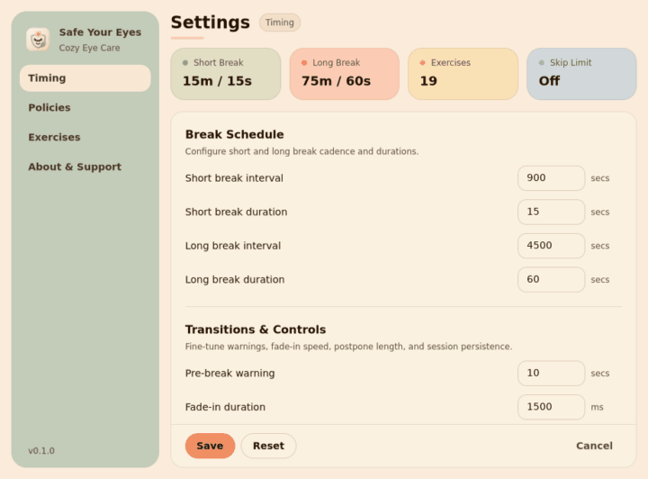
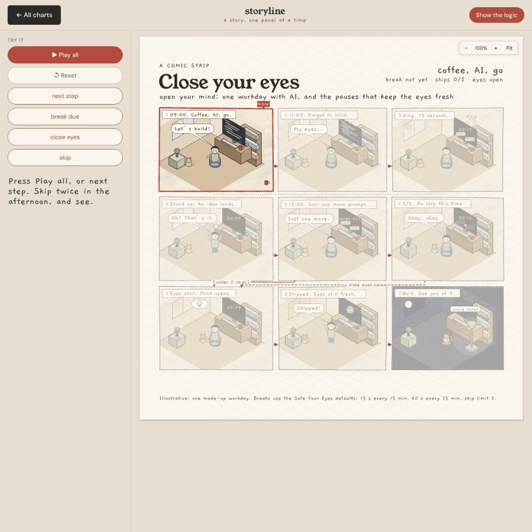

# Safe Your Eyes

Safe Your Eyes is a small Rust desktop application that protects your eyes on macOS, Windows, and Linux.
It follows the break cadence of [SafeEyes](https://github.com/slgobinath/safeeyes), renders native controls through [Native Shell (`longbridge/nsh`)](https://github.com/longbridge/nsh), and applies the [Cozy Design System](https://github.com/tunglt1810/cozy).





Read the 9-beat story in [docs/STORYLINE.md](docs/STORYLINE.md). Illustration drawn with [tinycharts](https://github.com/tunglt1810/tinycharts).

## Features

- **Single binary (`safe-your-eyes`)**: Runs the background daemon, CLI client, and on-demand GUI subprocesses from one compiled file.
- **No `tokio` runtime**: Uses `std::thread`, non-blocking local IPC, and native OS adapters.
- **[Cozy Design System](https://github.com/tunglt1810/cozy)**: Uses warm oatmeal (`#FAEBDA`) and espresso (`#261101`) in Light mode, and dark roast (`#18140E`) and warm cream (`#FFFEF7`) in Dark mode. The Settings window includes a Floating Sage Sidebar (`#C3CBB9` / `#29332A`), Pastel KPI summary cards, WCAG AAA coral buttons (`#EF8F63`), and Cozy spring/bezier motion with OS reduced-motion support.
- **Smart policies**: Supports strict break mode, Smart Pause on idle, Do Not Disturb (fullscreen, battery, window rules), consecutive skip limits, and synthesized PCM WAV chimes.

## Prerequisites

- Rust 1.97 or newer (Rust 2024 edition)
- **Linux**: `libgtk-4-dev` and `pkg-config` (`sudo apt-get install libgtk-4-dev pkg-config`)
- **macOS**: Xcode Command Line Tools (macOS 14 or newer)
- **Windows**: MSVC build tools (Windows 10 1809 or newer)

## Build and Test

```bash
# Run all unit tests and headless NSH UI tests
cargo test --workspace

# Build the debug binary
cargo build --bin safe-your-eyes

# Run all 72 opaque-box E2E tests (Python 3.11+ standard library only)
python3 e2e/run_e2e.py --bin target/debug/safe-your-eyes --tier all

# Build the size-optimized release binary
cargo build --release --bin safe-your-eyes
```

## Usage

```bash
# Start the background daemon
safe-your-eyes

# Check status (human-readable or JSON)
safe-your-eyes --status
safe-your-eyes --status --json

# Pause for 30 minutes, then resume
safe-your-eyes --disable 30
safe-your-eyes --enable

# Start a break immediately
safe-your-eyes --take-break
safe-your-eyes --short-break
safe-your-eyes --long-break

# Open the Cozy Settings window
safe-your-eyes --settings

# Print or validate configuration
safe-your-eyes --print-default-config
safe-your-eyes --validate-config --config /path/to/config.toml

# Stop the daemon cleanly
safe-your-eyes --quit
```

## Specification

Read the full product, architecture, Cozy design, and CLI specification in [docs/specs/SPEC.md](docs/specs/SPEC.md).

## Support

If Safe Your Eyes helps protect your vision, you can support the author here:

- **Buy Me a Coffee**: [https://buymeacoffee.com/bbeeezzzzz](https://buymeacoffee.com/bbeeezzzzz)

## License

GPL-2.0-only. See [LICENSE](LICENSE).
