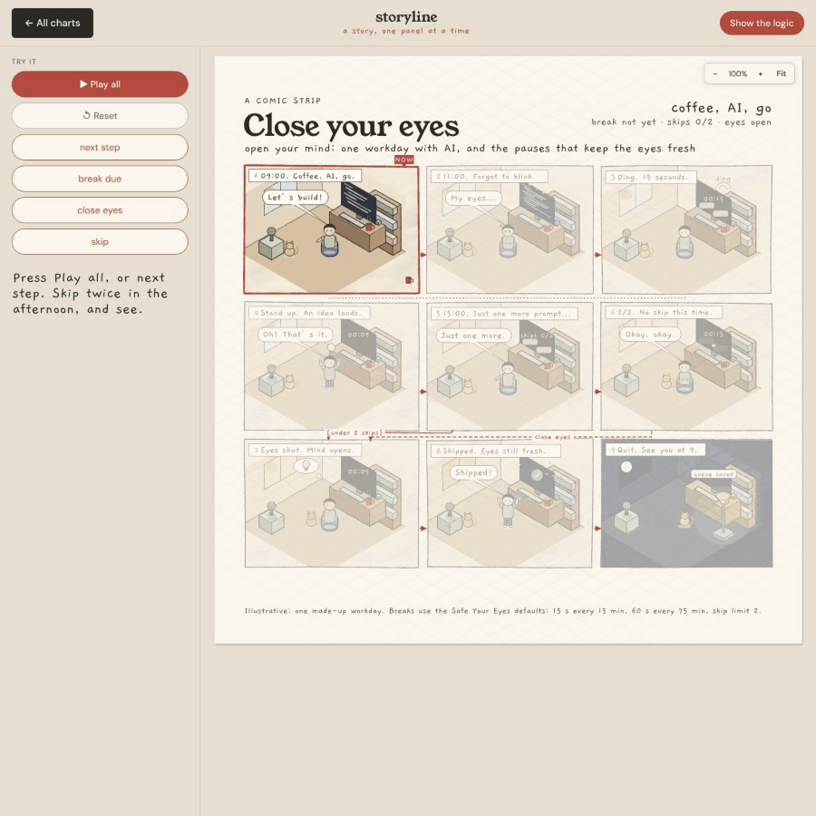
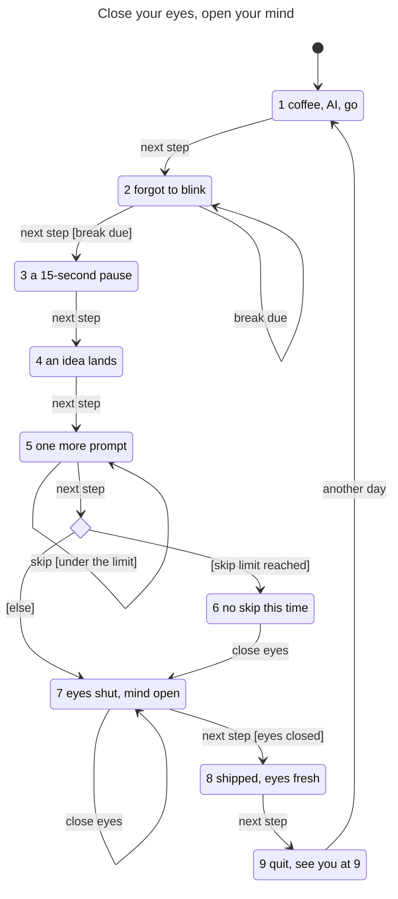

# Close Your Eyes, Open Your Mind



AI lets us build faster than ever. It also makes it easy to stare at a screen for hours without a blink.
This comic follows one workday. Small pauses keep the eyes fresh, and the best ideas come with the eyes shut.

Drawn with [tinycharts](https://github.com/tunglt1810/tinycharts).
Each section below matches one panel of the comic.
Read the technical details in [the specification](specs/SPEC.md).

## 1. 09:00. Coffee, AI, go.

Fresh coffee, a new task, and an AI that writes code as fast as you can read it.
Safe Your Eyes waits quietly in the tray at 0% GPU.

## 2. 11:00. Forgot to blink.

Two hours later the eyes are red and dry, and the coffee is cold.
Ten seconds before the break, a notice and a soft chime appear.

## 3. Ding. 15 seconds.

A 15-second overlay covers the screen.
For the first 2 seconds, `Space` and `Esc` do nothing, so a stray key press does not skip the rest.
You close your eyes.

## 4. Stand up. An idea lands.

After four short breaks, a 60-second long break asks you to stand and stretch.
Away from the stream of prompts, the idea that you looked for all morning arrives.

## 5. 15:00. Just one more prompt...

The afternoon sprint starts. Each break feels like it comes at the wrong time, so you skip it.

## 6. 2/2. No skip this time.

After two skips in a row, `SkipLimitPolicy` locks `Skip` and `Postpone`.
There is no way out of this break.

## 7. Eyes shut. Mind opens.

You close your eyes for 15 seconds. The skip counter goes back to 0.
You come back with a clearer prompt than the one you left.

## 8. Shipped. Eyes still fresh.

The work ships, and your eyes do not hurt.

## 9. Quit. See you at 9.

You run `safe-your-eyes --quit`.
With `persist_state` on, the daemon saves the `BreakQueue` position to `session.toml`, and the next day starts where this one stopped.

## Workday State Diagram



## Verified Workday Rules

- **Rest before you ship**: The day ships only after the eyes really close for the break.
- **Two skips at most**: After two skips in a row, `Skip` and `Postpone` lock.

## Build the comic again

The sheet source is in [`storyline/`](storyline/). Clone tinycharts next to this repository, then run from the repository root:

```bash
bun ../tinycharts/tinycharts/build/make.mjs docs/storyline/storyline.js -o .tmp/storyline.html --png .tmp/png
bun ../tinycharts/tinycharts/build/gif.mjs .tmp/storyline.html --width 900 --fps 12 -o docs/assets/storyline.gif
```
